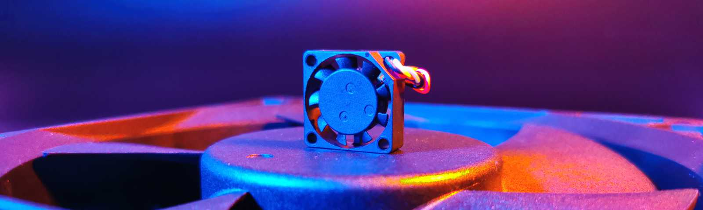
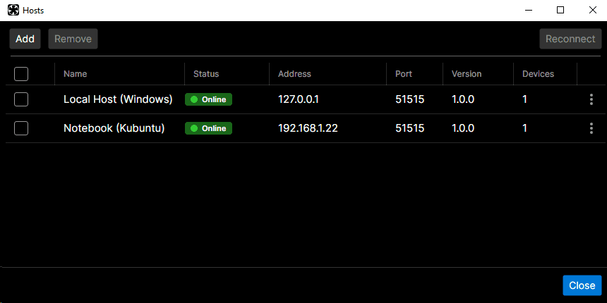
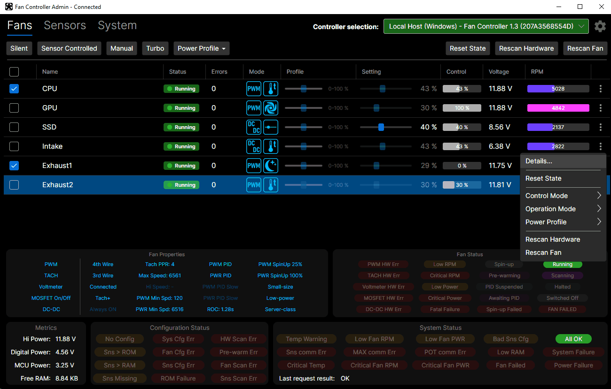

<h1>What is it and what is it for</h1>

Fan Controller is an open-source PC fan controller: a USB device that drives up to six fans by PWM and/or supply voltage, according to the readings of its own temperature sensors and of the computer's built-in ones (CPU, GPU, motherboard, drives).

The controller works on its own: once it has scanned the connected fans and sensors, it configures itself and shows the current state on its display. Control software for Windows and Linux makes it possible to monitor and fine-tune one or more controllers, locally or over the network.

The project consists of three parts, all published in this repository:

| Folder | Contents |
|---|---|
| [hardware](/hardware) | Schematic, PCB and Gerber files (also published on [OSHWLab](https://oshwlab.com/sneer2sneer/pc-fan-controller)) |
| [firmware](/firmware) | Firmware of the STM32F070CB microcontroller (STM32CubeIDE project) |
| [software](/software) | Host service (`FanController.Service`) and desktop application (`FanController`) |

<h1>How it works</h1>

```
 Temperature sensors ──► Fan Controller ──USB HID──► FanController.Service ◄──network──► FanController (UI)
 (DS18B20, built-in)     (6 fans, display)          (on every computer with            (any number of computers)
                                                      a controller connected)
```

- **The controller** measures the temperatures, calculates the required speed of every fan, and drives the fans by PWM and/or by the supply voltage of its DC-DC converters. It keeps working without a computer connection and even without the control software installed.
- **The service** runs in the background on the computer the controller is connected to. It passes the computer's own temperature sensors (CPU, GPU, motherboard, drives) to the controller, where they are used just like the hardware sensors.
- **The application** connects to the services of one or more computers and lets you monitor and configure every controller.

<p align="center"></p>

<h1>Features</h1>

<h2>Hardware</h2>

- All 6 fans controlled by PWM;
- 4 of them with the ability to adjust the supply voltage (three- or two-wire fans);
- 128 steps of smooth linear voltage adjustment;
- P-channel MOSFETs in the DC-DC converters, allowing almost lossless transmission of power to the fans (100% duty cycle);
- full shutdown possibility for each DC-DC converter;
- DC-DC output currents up to 4A (>15 Watts per channel);
- continued operation even when the microcontrollers fail;
- DC-DC supply voltage and output voltage sensors;
- 2 buses for digital temperature sensors (DS18B20);
- power and error indicators + alarm buzzer;
- IPS display 240x240;
- 32.768 kHz crystal for accurate fan speed measurement;
- USB connection;
- different power options: Molex (12V + 5V), Power 12V + USB, Molex + Power 12V, Single PS 5-18V;
- mounting holes for the HDD 2.5" holder.

<h2>Firmware</h2>

- detection of the fan channel hardware, the connected fans and their parameters, and configuration from the results;
- a total of up to 35 temperature sensors are supported;
- temperature sensors built into the digiPOTs and the microcontroller are supported (depends on the firmware settings);
- fan failure detection and redistribution of the load to the remaining fans;
- firmware update via USB.

More details: [firmware/README.md](/firmware/README.md).

<h2>Software</h2>

- Cross-platform control software (Windows/Linux) that supports network-based management of multiple controllers;
- tracking of the built-in PC temperature sensors (MB, CPU, GPU, HDD) via the control software;
- configuration backup and restore.

More details: [software/README.md](/software/README.md).

<h1>How to use it</h1>

1. **Assemble the board** (see [hardware/README.md](/hardware/README.md) and the [OSHWLab project](https://oshwlab.com/sneer2sneer/pc-fan-controller)).
2. **Flash the firmware:** take the files from the latest `firmware-v…` release and follow [firmware/README.md](/firmware/README.md#flashing). On the first start, the controller scans its fan channel hardware.
3. **Install the service** on the computer the controller is connected to, and start the application: see [software/README.md](/software/README.md). The service is optional: without it, the controller works with its own sensors only.
4. **Scan the fans and the sensors:** from the controller's menu or from the application. A fan scan takes up to 10 minutes per fan. Firmware built without display support runs these scans automatically on the first start. See [First start and scanning](/firmware/README.md#first-start-and-scanning).



More screenshots: [software/README.md](/software/README.md#screenshots).

<h1>Compatibility</h1>

The firmware and the software are released separately, with their own version tags (`firmware-vX.Y` and `software-vX.Y.Z`). The **major** version of the firmware defines the generation of the USB protocol; the service only works with controllers whose firmware major version it supports.

| Firmware | Software | Notes |
|---|---|---|
| 1.x | 1.x | Initial public release |

<h1>Feedback</h1>

Bug reports and feature requests are welcome via *Issues*; please choose the component (firmware, service, application or hardware) in the form. See [CONTRIBUTING.md](CONTRIBUTING.md). Security problems: see [SECURITY.md](SECURITY.md).

<h1>License</h1>

The source code of the firmware and the software, and the hardware design files, are licensed under the MIT license, see [LICENSE](LICENSE).

Third-party components are licensed under their own terms:
- firmware: [firmware/THIRD-PARTY-NOTICES.md](/firmware/THIRD-PARTY-NOTICES.md) (STMicroelectronics HAL, CMSIS and USB Device Library, and others);
- software: [software/THIRD-PARTY-NOTICES.md](/software/THIRD-PARTY-NOTICES.md).
<h1>Links</h1>

Hardware project on OSHWLab - [https://oshwlab.com/sneer2sneer/pc-fan-controller](https://oshwlab.com/sneer2sneer/pc-fan-controller)

Video about the hardware:

[](https://youtu.be/2WcZQeidf3s)
