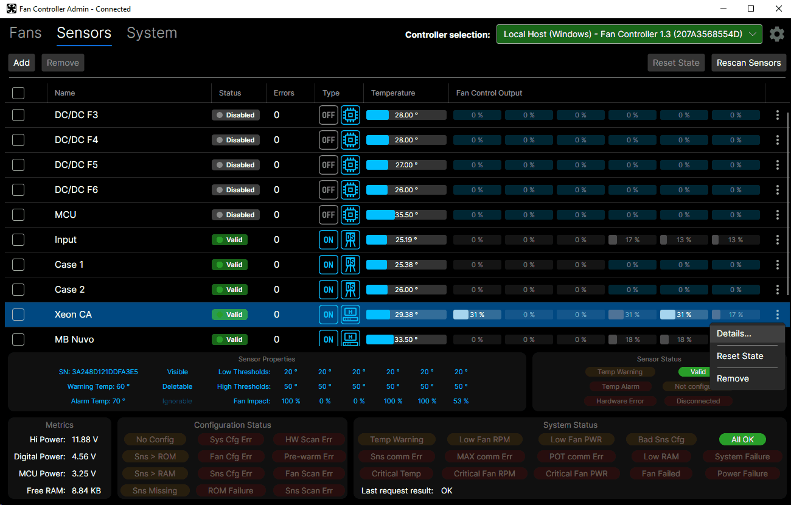
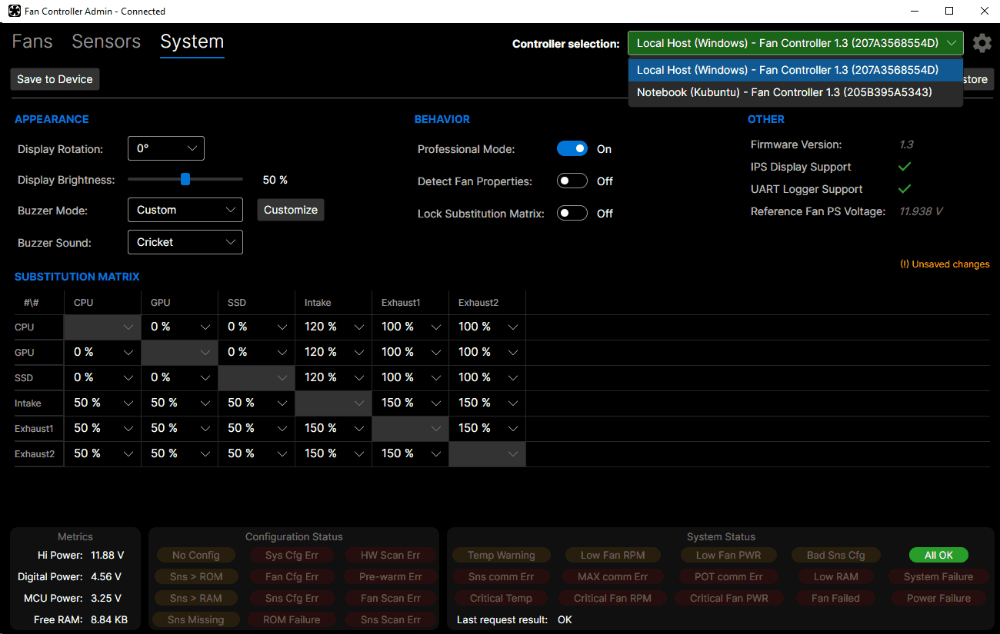
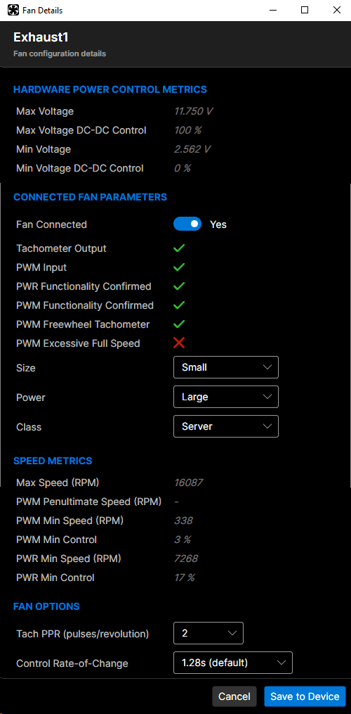

# Fan Controller

Software for the **Fan Controller** USB device: a background service that talks to
one or more controllers over USB HID, and a cross-platform desktop application to
monitor and configure them, locally or on other computers in the network.

This folder is part of the [Fan Controller](../README.md) project; see also the
[firmware](../firmware/README.md) and the [hardware](../hardware) of the controller.

## Overview

```
 Fan Controller device(s) ──USB HID──► FanController.Service ◄──gRPC (HTTP/2)──► FanController (UI)
                                       (one per host)                           (any number of hosts)
```

| Project | Description |
|---|---|
| `FanController.Service` | Windows service / Linux systemd daemon. Discovers the controllers, keeps their state, sends commands, and transmits the host's temperature sensors (CPU, GPU, storage, …) to the controllers. Serves a gRPC API on TCP port 51515. |
| `FanController` | Avalonia desktop application (Windows, Linux). Connects to the services of one or more hosts. |
| `FanController.Contracts` | gRPC service contract and data types shared by the service and the application. |

### Features

- Fan, sensor and system state monitoring of every connected controller
- Fan control modes (PWM, DC-DC, On/Off), operation modes and power profiles
- Fan hardware and model scanning, fan and sensor configuration
- Host temperature sensors as software sensors of the controller
  (Windows: LibreHardwareMonitor, Linux: hwmon)
- Fan substitution matrix, buzzer alarm options, display settings
- Configuration backup and restore (JSON)
- Several hosts and controllers in one application

### Screenshots

The **Fans** tab and the host list are shown in the [project README](../README.md).

**Sensors** tab: hardware (DS18B20), built-in and host sensors, with their temperatures and their impact on every fan.



**System** tab: display, buzzer and behavior options, and the fan substitution matrix. The controller list at the top contains the controllers of all hosts.



**Fan details**: the detected hardware and fan parameters, and the fan options.



## Requirements

- Windows 10/11 x64, or Linux x64 with systemd
- A Fan Controller device with firmware version 1.x
- To build: .NET 10 SDK (Visual Studio 2026 or the `dotnet` CLI)

The published packages are self-contained: the target computers don't need a .NET runtime.

## Download

The ready-to-use packages are attached to the `software-vX.Y.Z` releases (*Releases* on the
repository page):

| File | Contents |
|---|---|
| `FanController.Service-<version>-win-x64.zip` | Service for Windows, with the installation scripts |
| `FanController.Service-<version>-linux-x64.tar.gz` | Service for Linux, with the installation scripts |
| `FanController-<version>-win-x64.zip` | Application for Windows |
| `FanController-<version>-linux-x64.tar.gz` | Application for Linux |

Extract the Linux packages with `tar -xzf <file>.tar.gz` (this keeps the executable
permissions). To build the packages yourself, see below.

## Building

```bash
dotnet build FanController.sln -c Release
```

Publishing uses the profiles in `Properties/PublishProfiles` of each project
(Visual Studio: *Publish*), or the CLI, for example:

```bash
dotnet publish FanController.Service/FanController.Service.csproj -c Release -r linux-x64 --self-contained -p:PublishSingleFile=true
```

The installation scripts are copied into the publish folder of the service. A Linux publish
also packs the publish folder into a `.tar.gz` file next to it.

## Installing the service

The service must be installed on every computer the controllers are connected to.
It runs with administrator / root privileges (USB access, hardware sensors).

### Windows

Run in an elevated PowerShell (Run as administrator), in the extracted service package
(or the publish folder):

```powershell
.\install-service.ps1
```

If PowerShell refuses to run the script (execution policy, or a file downloaded from the
Internet), run it as
`powershell -ExecutionPolicy Bypass -File .\install-service.ps1`.

- Installs to `C:\Program Files\FanControllerService` and registers the
  `FanControllerService` service (automatic start, restart on failure).
- Checks for the **PawnIO** driver, which LibreHardwareMonitor needs for CPU,
  chipset and Super I/O sensors. If it is missing, the script downloads the official
  signed installer from the PawnIO project and installs it (`-SkipPawnIO` to skip;
  a `PawnIO_setup.exe` placed next to the script is used instead of downloading).
- Uninstall: `.\uninstall-service.ps1`

### Linux

In the extracted service package (or the publish folder):

```bash
sudo bash install-service.sh
```

- Installs to `/opt/fancontrollerservice` and enables the `fancontrollerservice`
  systemd unit.
- Status and logs: `systemctl status fancontrollerservice`,
  `journalctl -u fancontrollerservice -f`
- Uninstall: `sudo bash uninstall-service.sh`

### Configuration

`appsettings.json` in the installation folder:

| Setting | Default | Description |
|---|---|---|
| `Service:GrpcPort` | 51515 | TCP port of the gRPC API |
| `Service:Logging:RollingInterval` | Day | Log file rolling interval |
| `Service:Logging:RetainedFileCountLimit` | 30 | Number of log files kept |
| `Serilog:MinimumLevel` | Information | Log levels (per component) |

Log files:

| OS | Location |
|---|---|
| Windows | `C:\ProgramData\FanController\Logs` |
| Linux | `/var/log/fancontroller` |
| Fallback | `logs` next to the executable |

## Running the application

Start `FanController` (Windows: `FanController.exe`). The local host
(`127.0.0.1:51515`) is configured by default; other computers are added in the
host list (gear button). The application settings are stored in
`%LOCALAPPDATA%\FanController\settings.json` (Windows) or
`~/.local/share/FanController/settings.json` (Linux).

The application and the service must use the same contract version; a host with an
incompatible service version is shown as *Incompatible* in the host list. Update
both together.

## Security notice

The service accepts **unauthenticated, unencrypted** gRPC connections on TCP port
51515 on **all network interfaces**, and runs with administrator / root privileges.
Anyone who can reach this port can read the sensor data and change the controller
configuration, including a factory reset.

- Run the service only on trusted networks.
- Block the port in your firewall if you don't need remote access.
- On Windows, remote access requires an inbound firewall rule for the port;
  on Linux, the port is usually reachable without one.

## Device identification

The service opens USB HID devices with VID `0x0483`, PID `0x5750`, manufacturer
string "Dmitry Muravyev" and product string "Fan Controller", firmware major
version 1. The VID/PID pair is the one of STMicroelectronics' Custom HID examples;
the string check keeps other boards with the same IDs out.

## Feedback

Bug reports and feature requests are welcome via *Issues*; see
[CONTRIBUTING.md](../CONTRIBUTING.md). Security problems: see [SECURITY.md](../SECURITY.md).

## License

MIT, see [LICENSE](../LICENSE). Third-party components and their licenses are listed in
[THIRD-PARTY-NOTICES.md](THIRD-PARTY-NOTICES.md).
